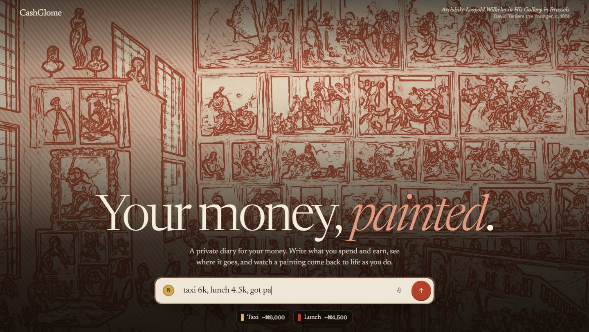
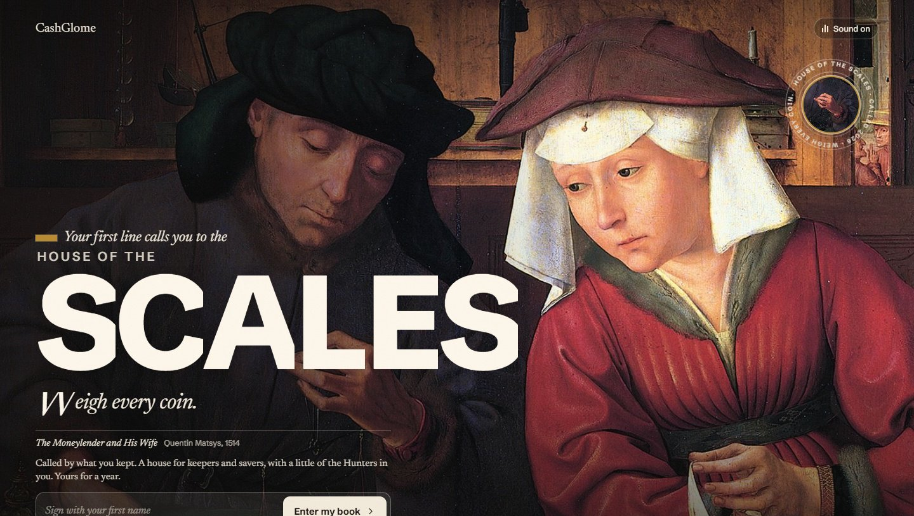
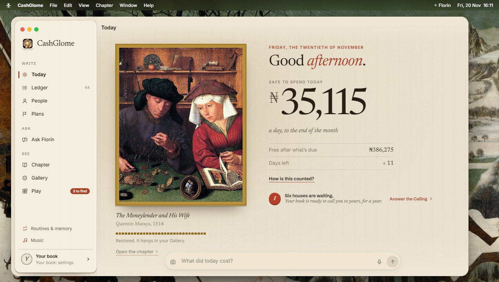
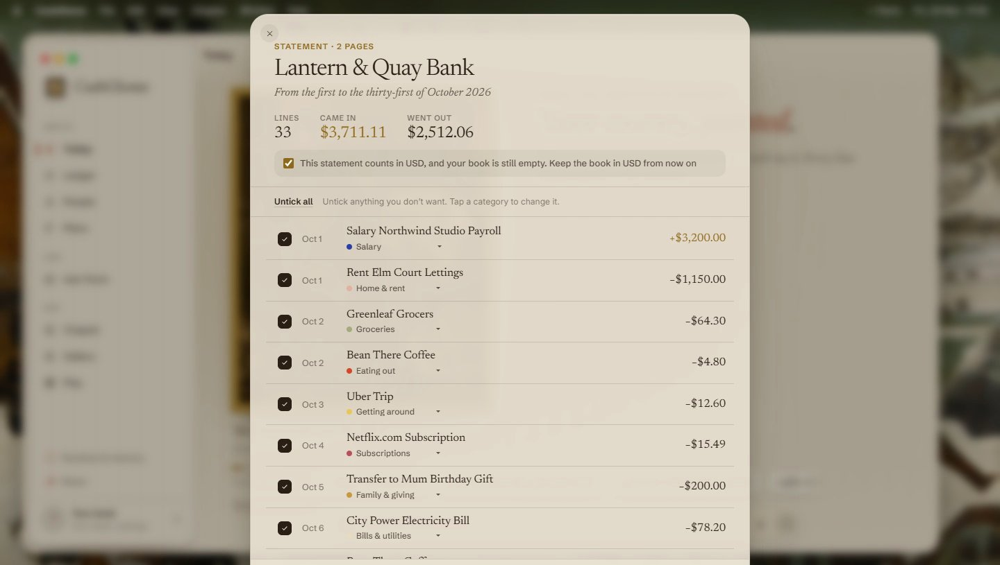
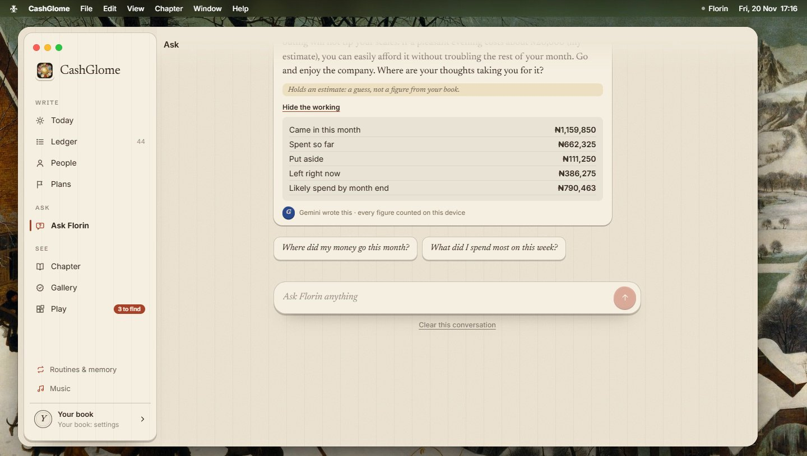

<p align="center">
  
</p>

<p align="center">
  <b>A private money diary for people paid in cash and transfers. You write what came in and what went out, in any language; an Old Master painting comes alive around it, and its sitters answer back.</b>
</p>

<p align="center">
  <a href="https://cashglome-gallery.vercel.app"></a>
  
  
  
  
  
  
  
</p>

<p align="center">
  <a href="https://cashglome-gallery.vercel.app"><b>Open the live app</b></a> ·
  <a href="#the-problem">The problem</a> ·
  <a href="#what-happens-in-the-first-ten-seconds">First ten seconds</a> ·
  <a href="#florin-ask-anything">Florin</a> ·
  <a href="#hybrid-ai-what-runs-where">Hybrid AI</a> ·
  <a href="#run-it-locally">Run it</a> ·
  <a href="#the-paintings">The paintings</a>
</p>

## Firebase #BuildHybridAI Hackathon · Submission

| | |
|---|---|
| **Category** | Web |
| **What it is** | A money diary you write in one line ("bolt 6k, lunch 4.5k, got paid 350k"), set inside a living Old Master. Every entry glazes a patch of the painting into colour; the sitters speak; the month's painting is yours to keep. |
| **Hybrid AI** | **Gemini in the cloud** is the default, so a modest laptop, an older phone or a cheap PC gets an answer as fast as a new machine, with nobody waiting on hardware that can't run a model quickly: it reads lines in any language, and for the sitters it sees categories, never the line or the sums. **Gemini Nano on the device** takes over offline: with no connection, it reads lines, voices the sitters and answers Ask, and nothing leaves the browser. Online, on a computer where Nano is already installed and passes a one-time speed check, Nano and the cloud answer together and the faster answer is used (Nano's wins if it lands within 0.4 s of the cloud's), so a strong machine reads on the device while a weak one never waits. **Florin**, the painting's voice, is a Gemini conversation about anything ("should I go on a date this weekend?") that calls tools running on the device for every figure. Every result is labelled with where it ran: *Read by Gemini Nano, on this device* or *Read with Gemini, in the cloud*. |
| **Not a prompt wrapper** | No model ever does arithmetic. The model reads words into entries and talks; the device adds everything up exactly and shows its working. A rules engine reads English and pidgin offline with no model at all. |
| **Provenance** | CashGlome existed before the hackathon; its history is kept unchanged in the first 11 commits. Two more were made on the morning of 11 November, before the period opened; everything from `50fe538` on was built during the submission period. See [Before and during the hackathon](#before-and-during-the-hackathon). |

## Before and during the hackathon

**Before the hackathon.** CashGlome existed as a private-repository app and was already public at cashglome.vercel.app. Its history is kept unchanged in the first 11 commits of this repo, up to [`27382dc`](https://github.com/aboderinsamuel/CashGlome-LivingGallery/commit/27382dc) (10 November 2026, 4:12 PM PT). It already had:
- the offline money reader (English and pidgin, k/m, 20 currencies) and the ledger;
- monthly Chapters, each with a painting cleaned by a flat varnish wipe, and a gallery of past months;
- an Ask panel that sent questions to another provider's cloud chat model (now switched off, with no Google or Firebase anywhere);
- Spotify's embedded player, a share card and Plans;
- optional accounts with sync (Supabase; the schema is in `supabase/`), now switched off: they stored entries the server could read, and they stay off until the backup is end-to-end encrypted.

**The core value it brings.** People in cash and bank-transfer economies need a money reader that understands how they actually write, works offline and keeps entries on the device. That reader and ledger are the foundation everything below is built on.

**The morning before the start.** Two commits on 11 November came before the submission period opened at 1:30 PM PT: [`07860fc`](https://github.com/aboderinsamuel/CashGlome-LivingGallery/commit/07860fc) (7:57 AM PT), which rewrote the money reader, and [`5e5f583`](https://github.com/aboderinsamuel/CashGlome-LivingGallery/commit/5e5f583) (12:22 PM PT), which exported its test cases as one JSON contract. The tag [`contest-start`](https://github.com/aboderinsamuel/CashGlome-LivingGallery/releases/tag/contest-start) marks the first of them, where hackathon work began; count both as prior work.

**Built during the submission period** (from 11 November 2026, 1:30 PM PT; the first commit in the window is [`50fe538`](https://github.com/aboderinsamuel/CashGlome-LivingGallery/commit/50fe538), at 5:23 PM PT; every change since is in [this comparison](https://github.com/aboderinsamuel/CashGlome-LivingGallery/compare/5e5f583...main)):
- **The Firebase hybrid brain** ([`src/stage/brain.ts`](https://github.com/aboderinsamuel/CashGlome-LivingGallery/blob/main/src/stage/brain.ts)). Firebase AI Logic with Gemini Nano on the device and Gemini in the cloud, with the cloud first so any device is fast, Nano alongside online where a speed check finds it quick, and Nano alone offline, with App Check and reCAPTCHA Enterprise. None of it existed before.
- **Florin** ([`src/stage/florin.ts`](https://github.com/aboderinsamuel/CashGlome-LivingGallery/blob/main/src/stage/florin.ts)). A Gemini chat with function calling, in which tools on the device do every sum and the answer shows its working. It replaces the old Ask panel, which has been deleted.
- **The money reader, extended.** Nine more languages read on the device and five more currencies, on top of the rewrite made that morning.
- **The living canvas.** One WebGL2 shader takes each painting from a red-chalk underdrawing through grisaille and glaze to varnish, with brush strokes, mood light and candlelight. It replaces the flat varnish wipe.
- **A world library of 57 public-domain masters.** The paintings come from China, Korea, Japan, India, Persia, Africa and the Americas as well as Europe, hung so that no month repeats until the whole library has been shown.
- **The sitters, the evening sitting and Discoveries.**
- **Folio, a new design language.** It covers the painted, sign-up-free onboarding, a sidebar in three acts (Write, See, Ask), and Today, Ledger, People and Chapter.
- **Play.** Twelve painting-puzzle Rooms with seals, scored without streaks or ranks.
- **The phone layout,** tested at 360 and 412 pixels wide.
- **Spotify sign-in and in-app search,** which runs as a server function so the secret never reaches a browser.
- **No streaks or ranks anywhere.**

## The problem

About 1.4 billion adults have no bank account, and many more are paid in cash, mobile money and bank transfers that no budgeting app can see. Bank-linking apps don't work for them, and spreadsheets don't survive a week. What people actually ask is simple:

- **Can I afford this?** The safe amount to spend until the next money comes in.
- **Where did it all go?** A month told back as a story, not a chart.
- **Who owes who?** Lent, borrowed and split, kept straight with people and circles.
- **Is my rotating savings circle on track?** Tontine, tanda, susu, hui, kye, chit fund, stokvel, arisan, partner.
- **How fast are my own prices rising?** A personal inflation rate from what you really buy.
- **Can I prove my income?** A clean record for a landlord or a lender.

CashGlome answers these from one line a day, privately, on the device, with no bank login and no sign-up before the first entry.

## What happens in the first ten seconds

1. Teniers's painted gallery fills the screen as a **red-chalk underdrawing**, the way a Renaissance workshop started a panel. You write a line the way you'd say it (`taxi 6k, lunch 4.5k, got paid 350k`); it becomes entries as you type, and each one lands as a stroke of colour on a canvas in the room.
2. **The Calling.** The room goes dark, a frame draws itself, and six house paintings flicker inside it until one holds. Your first line calls you to your house for the year: the House of the Scales (*Weigh every coin*), the Feast, the Hunters, Athens, the Wave or the River.
3. **Sign the house book** with your first name, or skip it. No account, no email. *Enter my book*, and it opens on Today, already holding your line.

On a wide screen the book opens as a desk, with a menu bar, a window, widgets and a dock; on a phone it is a phone app with tabs along the bottom.

<p align="center">
  
  
  
</p>

## Bring in what you already have

Typing is only one way in, and all of these are read on the device:

- **Snap a receipt.** The photo is read in the browser (Tesseract), the total and a category are filled in, and the photo is never uploaded.
- **Say it.** The microphone button takes "coffee three thousand, bus fare fifteen hundred" and writes the entries as you speak.
- **Drop in a bank statement.** A PDF or CSV is read on the device (pdf.js): every line is shown for review, duplicates are unticked, and nothing is written until you say so. Then ask Florin *"What does my statement say about me?"* Three fictional sample statements are built in to try.

<p align="center">
  
  
</p>

As the month goes on, the whole canvas moves through **sinopia → grisaille → glaze → varnish**. The week's money sets the light: calm is Vermeer's window, a rush brings Caravaggio's dark in from the edges, plenty gilds the highlights, and after dark the room goes to candlelight.

## One small act a day

Nobody types every expense forever, so the daily act is the reward, not the chore:

- **The evening sitting.** In the evening, Today opens on the month's painting by candlelight and asks one question: *what did today cost?* One line is enough.
- **"Nothing today" counts.** A quiet day is kept with one tap and cleans a patch, the same as a line. A missed day costs nothing: no streaks, no guilt.
- **Discoveries.** At a third, two thirds and the whole of the restoration, a curator's lens finds a detail people walk past: the mirror in *The Moneylender and His Wife*, the falling inn sign in *Hunters in the Snow*. Keeping the book teaches you the painting.
- **Florin.** Ask the painting anything. It knows your book, it's warm and a little dry, and it never scolds.

## Florin: ask anything

Florin speaks as a figure in the month's painting. It's a real Gemini conversation, so it'll talk about a date, a trip, a bad week or the painting itself, and bring your money in when it matters.

- It gets a **summary of the book** (this month's totals by category, what's free to spend, who owes whom) and **tools that run on the device**: `search_entries` (exact totals, counts and a category split) and `can_afford` (balance, routines and pay day). Any figure from your book comes from those, copied exactly, and the answer shows the same figures as its working.
- When it **guesses** (what a dinner for two usually costs), it says so, and the answer is labelled *holds an estimate*.
- **Offline**, Ask sends nothing: Gemini Nano answers if the browser has it, the book's own rules if not.
- Code: [`src/stage/florin.ts`](src/stage/florin.ts).

## Hybrid AI: what runs where

| Task | On the device (Gemini Nano via Firebase AI Logic) | In the cloud (Gemini) | Why |
|---|---|---|---|
| Read a line in another language or script | Offline, and online where Nano is quick; sees the line | Always online; the faster answer is used | Fast on any device, strong or not; the line stays on the device offline |
| A sitter's reply | Offline; sees your line | First choice; sees only the kinds of things bought | The cloud never gets the line or the sums |
| Today's museum label | Offline (`PREFER_ON_DEVICE`) | First choice | Only categories go in, so either is safe |
| Florin, a conversation about anything | Offline; given the device's figures | Gemini with function calling: the question, a summary of the book, and tool results | Talk needs a big model; every figure still comes from the device |
| Sums, totals, safe to spend | Always, in plain code | Never | Arithmetic is never left to a model |

The brain is [`src/stage/brain.ts`](src/stage/brain.ts). It decides what may leave the device before any call is made, rather than leaving that to the SDK, and every result returns `inferenceSource` so each answer can say "Read by Gemini Nano, on this device" or "Read with Gemini, in the cloud". App Check with reCAPTCHA Enterprise keeps the Gemini API for this app only.

Gemini Nano runs in desktop Chrome where the browser provides it. Online, the app never downloads Nano and never loads it on a guess: on a small integrated GPU a single Nano reply took a minute or more in our tests and loading the model stalled the page. So the first time the page is idle, a one-time check runs where Nano is already installed. It skips graphics known to be too small, then times one short reply and gives up after 8 seconds. A machine that answers within 1.5 s uses Nano online, racing the cloud; the rest keep the cloud alone, and a machine that loses three races in a row goes back to the cloud by itself. The result is kept per Chrome version. When the connection drops, Nano loads and takes over everywhere it exists. With no Firebase config at all, the rules engine and the sitters' own written lines carry on alone. The diary never breaks.

## The living canvas

One WebGL2 fragment shader paints the whole scene from a single public-domain image ([`src/stage/shader.ts`](src/stage/shader.ts)):

- **Sinopia:** a Sobel edge pass drawn as red chalk on linen, with light hatching in the shadows.
- **Grisaille, glaze, varnish:** the month's stage blends tone, colour and a warm varnish.
- **Brush strokes:** each entry paints a soft body of glaze plus nine bristles into a mask; dry bristles run out first, and the canvas weave catches paint unevenly at the edge.
- **Mood light:** Vermeer's window for calm weeks, Caravaggio's dark for rushed ones, Venetian gold for plenty, Northern slate for heavy obligations.
- **Night:** candlelight that flickers, a lantern that follows the pointer (or the tilt of a phone), and dust turning in the light.

## The paintings

57 public-domain masterpieces from every continent, each with a museum label and, where it has one, its title in its own script: Bruegel, van Eyck, Matsys, Caravaggio, Vermeer, Velázquez and Teniers beside Zhang Zeduan's *Along the River During the Qingming Festival* (清明上河圖), Kim Hong-do's *Ssireum* (씨름), Hokusai, Hiroshige, Raja Ravi Varma, the Shahnameh, the Baburnama, Ancient Egypt, Pancho Fierro and George Caleb Bingham.

Every image comes from Wikimedia Commons and was checked to be public domain before download ([`scripts/fetch-art.mjs`](scripts/fetch-art.mjs)). Works whose files carry a share-alike licence were left out.

The music on the first screens is a shortened edit of Antonio Vivaldi, *The Four Seasons*, Winter, I. *Allegro non molto*, played by John Harrison and the Wichita State University Chamber Players, from Wikimedia Commons under [CC BY-SA 4.0](https://creativecommons.org/licenses/by-sa/4.0/). The edit ([`public/audio/overture.mp3`](public/audio/overture.mp3)) is shared under the same licence; details in [`public/audio/CREDITS.md`](public/audio/CREDITS.md).

## Run it locally

```bash
git clone https://github.com/aboderinsamuel/CashGlome-LivingGallery.git
cd CashGlome-LivingGallery
npm install
npm run dev
```

It runs with no keys at all (rules engine and written sitter lines). To turn on Gemini, create a Firebase project with AI Logic and App Check, and copy `.env.example` to `.env.local`:

```bash
VITE_FIREBASE_API_KEY=...
VITE_FIREBASE_AUTH_DOMAIN=your-project.firebaseapp.com
VITE_FIREBASE_PROJECT_ID=your-project
VITE_FIREBASE_APP_ID=...
VITE_RECAPTCHA_SITE_KEY=...        # reCAPTCHA Enterprise key registered in App Check
VITE_APPCHECK_DEBUG_TOKEN=...      # local only: a debug token registered in App Check
```

Firebase web config is public by design; App Check is what protects the API. To try Gemini Nano, use desktop Chrome with the built-in AI model available.

The README hero is rendered by the app's own shader: `npx electron scripts/make-hero.cjs` with the dev server running.

## Principles we don't bend

Entries live on the device and work offline. No sign-up before the first entry. No ads, no bank login, no streaks, no guilt: missing a day costs nothing. No red and green charts.

The full product story, the money reader's design and the desktop and phone apps are in [`docs/PRODUCT.md`](docs/PRODUCT.md).

## Licence

[Apache 2.0](LICENSE). The paintings are in the public domain; their museum labels credit the artist, the work and the collection. The overture recording is CC BY-SA 4.0 (see above).
