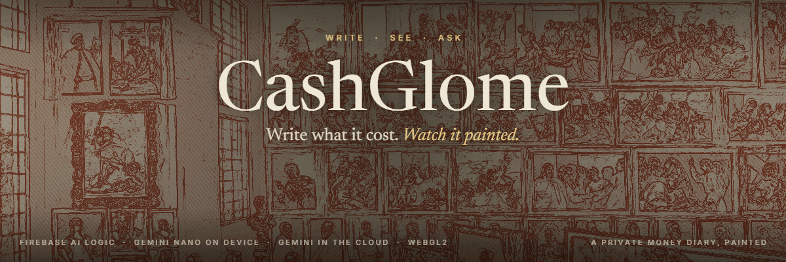
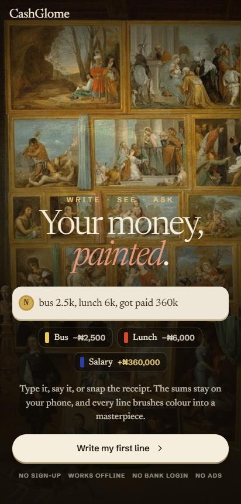
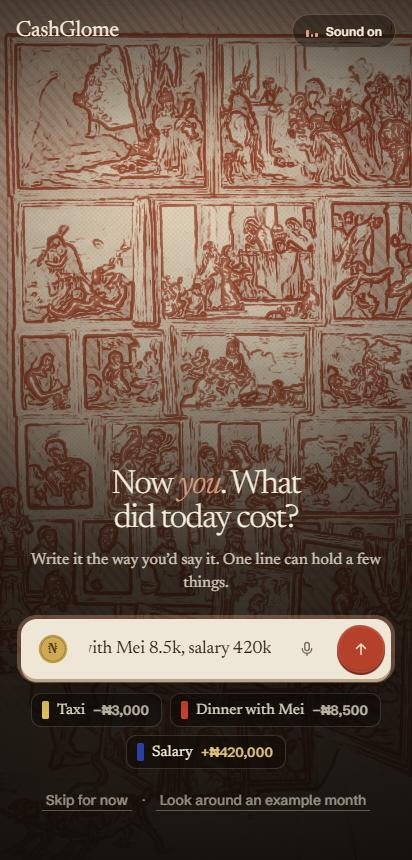
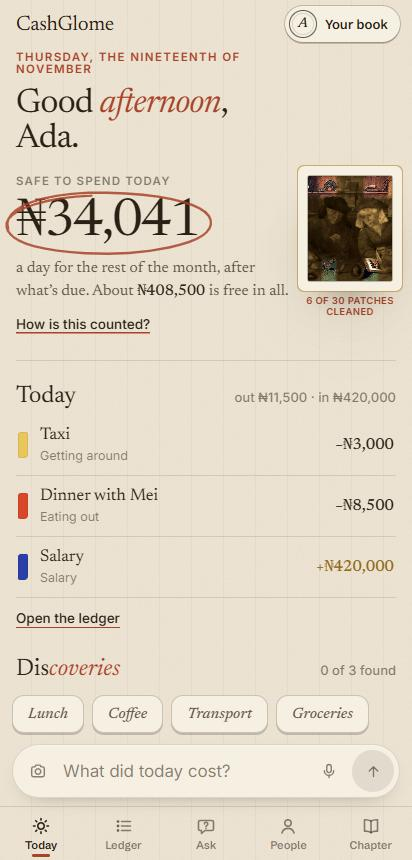
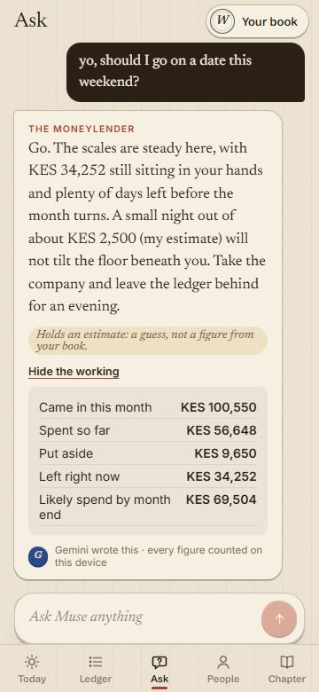

<p align="center">
  
</p>

<p align="center">
  <b>A private money diary for people paid in cash and transfers. You write what came in and what went out, in any language; an Old Master painting comes alive around it, and its sitters answer back.</b>
</p>

<p align="center">
  <a href="https://cashglome-gallery.vercel.app"></a>
  
  
  
  
  
  
  
</p>

<p align="center">
  <a href="https://cashglome-gallery.vercel.app"><b>Open the live app</b></a> ·
  <a href="#the-problem">The problem</a> ·
  <a href="#what-happens-in-the-first-ten-seconds">First ten seconds</a> ·
  <a href="#florin-ask-anything">Florin</a> ·
  <a href="#hybrid-ai-what-runs-where">Hybrid AI</a> ·
  <a href="#run-it-locally">Run it</a> ·
  <a href="#the-paintings">The paintings</a>
</p>

## Firebase #BuildHybridAI Hackathon · Submission

| | |
|---|---|
| **Category** | Web |
| **What it is** | A money diary you write in one line ("bolt 6k, lunch 4.5k, got paid 350k"), set inside a living Old Master. Every entry glazes a patch of the painting into colour; the sitters speak; the month's painting is yours to keep. |
| **Hybrid AI** | **Gemini Nano on the device** reads lines in any language and voices the sitters, and the person's own words never leave the browser. **Gemini in the cloud** takes over only when the device has no model, and then sees categories, never the line or the sums. **Florin**, the painting's voice, is a Gemini conversation about anything ("should I go on a date this weekend?") that calls tools running on the device for every figure. Every result carries a wax seal that says where it was written. |
| **Not a prompt wrapper** | No model ever does arithmetic. The model reads words into entries and talks; the device adds everything up exactly and shows its working. A rules engine reads English and pidgin offline with no model at all. |
| **Provenance** | CashGlome's money reader and ledger existed before the hackathon in a private repository; that history is kept here, honestly, in the first 15 commits. Everything hackathon-specific (the living canvas and its shader, the Firebase hybrid brain, Florin, the sitters, the 58-painting world library, the painted onboarding, the evening sitting and Discoveries, the Folio design) is in the commits after them. |

## The problem

About 1.4 billion adults have no bank account, and many more are paid in cash, mobile money and bank transfers that no budgeting app can see. Bank-linking apps don't work for them, and spreadsheets don't survive a week. What people actually ask is simple:

- **Can I afford this?** The safe amount to spend until the next money comes in.
- **Where did it all go?** A month told back as a story, not a chart.
- **Who owes who?** Lent, borrowed and split, kept straight with people and circles.
- **Is my rotating savings circle on track?** Tontine, tanda, susu, hui, kye, chit fund, stokvel, arisan, partner.
- **How fast are my own prices rising?** A personal inflation rate from what you really buy.
- **Can I prove my income?** A clean record for a landlord or a lender.

CashGlome answers these from one line a day, privately, on the device, with no bank login and no sign-up before the first entry.

## What happens in the first ten seconds

1. Teniers's painted gallery fills the screen as a **red-chalk underdrawing**, the way a Renaissance workshop started a panel. A line writes itself (`bus 2.5k, lunch 6k, got paid 360k`), and each entry lands as a stroke of colour on a canvas in the room.
2. **Your turn.** "Now *you*. What did today cost?" You write your own line, in your own words and currency; it becomes entries as you type, and each one glazes a patch back into colour.
3. **Who keeps this book?** Your first name, or skip it. No account, no email.
4. A **wax seal** presses down: *Chapter one begins.* The book opens on Today, already holding your first line.

<p align="center">
  
  
  
  
</p>

As the month goes on, the whole canvas moves through **sinopia → grisaille → glaze → varnish**. The week's money sets the light: calm is Vermeer's window, a rush brings Caravaggio's dark in from the edges, plenty gilds the highlights, and after dark the room goes to candlelight.

## One small act a day

Nobody types every expense forever, so the daily act is the reward, not the chore:

- **The evening sitting.** In the evening, Today opens on the month's painting by candlelight and asks one question: *what did today cost?* One line is enough.
- **"Nothing today" counts.** A quiet day is kept with one tap and cleans a patch, the same as a line. A missed day costs nothing: no streaks, no guilt.
- **Discoveries.** At a third, two thirds and the whole of the restoration, a curator's lens finds a detail people walk past: the mirror in *The Moneylender and His Wife*, the falling inn sign in *Hunters in the Snow*. Keeping the book teaches you the painting.
- **Florin.** Ask the painting anything. It knows your book, it's warm and a little dry, and it never scolds.

## Florin: ask anything

Florin speaks as a figure in the month's painting. It's a real Gemini conversation, so it'll talk about a date, a trip, a bad week or the painting itself, and bring your money in when it matters.

- It gets a **summary of the book** (this month's totals by category, what's free to spend, who owes whom) and **tools that run on the device**: `search_entries` (exact totals, counts and a category split) and `can_afford` (balance, routines and pay day). Any figure from your book comes from those, copied exactly, and the answer shows the same figures as its working.
- When it **guesses** (what a dinner for two usually costs), it says so, and the answer is labelled *holds an estimate*.
- **Keep Ask on this device** sends nothing: Gemini Nano answers if the browser has it, the book's own rules if not. **Offline** works the same way.
- Code: [`src/stage/muse.ts`](src/stage/muse.ts).

## Hybrid AI: what runs where

| Task | On the device (Gemini Nano via Firebase AI Logic) | In the cloud (Gemini) | Why |
|---|---|---|---|
| Read a line in another language or script | First choice; sees the line | Only if the device has no model | Your words are the most private thing in the app |
| A sitter's reply | Sees your line | Sees only the kinds of things bought | Wit needs context; the cloud gets none |
| Today's museum label | `PREFER_ON_DEVICE` | Fallback | Only categories go in, so either is safe |
| Florin, a conversation about anything | When "Keep Ask on this device" is on, or offline; given the device's figures | Gemini with function calling: the question, a summary of the book, and tool results | Talk needs a big model; every figure still comes from the device |
| Sums, totals, safe to spend | Always, in plain code | Never | Arithmetic is never left to a model |

The brain is [`src/stage/brain.ts`](src/stage/brain.ts). It decides what may leave the device before any call is made, rather than leaving that to the SDK, and every result returns `inferenceSource` so the wax seal can say "Read on this device" or "Read in the cloud". App Check with reCAPTCHA Enterprise keeps the Gemini API for this app only.

Gemini Nano runs in desktop Chrome where the browser provides it. Everywhere else the cloud carries on, and with no Firebase config at all the rules engine and the sitters' own written lines carry on alone. The diary never breaks.

## The living canvas

One WebGL2 fragment shader paints the whole scene from a single public-domain image ([`src/stage/shader.ts`](src/stage/shader.ts)):

- **Sinopia:** a Sobel edge pass drawn as red chalk on linen, with light hatching in the shadows.
- **Grisaille, glaze, varnish:** the month's stage blends tone, colour and a warm varnish.
- **Brush strokes:** each entry paints a soft body of glaze plus nine bristles into a mask; dry bristles run out first, and the canvas weave catches paint unevenly at the edge.
- **Mood light:** Vermeer's window for calm weeks, Caravaggio's dark for rushed ones, Venetian gold for plenty, Northern slate for heavy obligations.
- **Night:** candlelight that flickers, a lantern that follows the pointer (or the tilt of a phone), and dust turning in the light.

## The paintings

58 public-domain masterpieces from every continent, each with a museum label and, where it has one, its title in its own script: Bruegel, van Eyck, Matsys, Caravaggio, Vermeer, Velázquez and Teniers beside Zhang Zeduan's *Along the River During the Qingming Festival* (清明上河圖), Kim Hong-do's *Ssireum* (씨름), Hokusai, Hiroshige, Raja Ravi Varma, the Shahnameh, the Baburnama, Ancient Egypt, Pancho Fierro and George Caleb Bingham.

Every image comes from Wikimedia Commons and was checked to be public domain before download ([`scripts/fetch-art.mjs`](scripts/fetch-art.mjs)). Works whose files carry a share-alike licence were left out.

The music on the first screens is a shortened edit of Antonio Vivaldi, *The Four Seasons*, Winter, I. *Allegro non molto*, played by John Harrison and the Wichita State University Chamber Players, from Wikimedia Commons under [CC BY-SA 4.0](https://creativecommons.org/licenses/by-sa/4.0/). The edit ([`public/audio/overture.mp3`](public/audio/overture.mp3)) is shared under the same licence; details in [`public/audio/CREDITS.md`](public/audio/CREDITS.md).

## Run it locally

```bash
git clone https://github.com/aboderinsamuel/CashGlome-LivingGallery.git
cd CashGlome-LivingGallery
npm install
npm run dev
```

It runs with no keys at all (rules engine and written sitter lines). To turn on Gemini, create a Firebase project with AI Logic and App Check, and copy `.env.example` to `.env.local`:

```bash
VITE_FIREBASE_API_KEY=...
VITE_FIREBASE_AUTH_DOMAIN=your-project.firebaseapp.com
VITE_FIREBASE_PROJECT_ID=your-project
VITE_FIREBASE_APP_ID=...
VITE_RECAPTCHA_SITE_KEY=...        # reCAPTCHA Enterprise key registered in App Check
VITE_APPCHECK_DEBUG_TOKEN=...      # local only: a debug token registered in App Check
```

Firebase web config is public by design; App Check is what protects the API. To try Gemini Nano, use desktop Chrome with the built-in AI model available.

The README hero is rendered by the app's own shader: `npx electron scripts/make-hero.cjs` with the dev server running.

## Principles we don't bend

Entries live on the device and work offline. No sign-up before the first entry. No ads, no bank login, no streaks, no guilt: missing a day costs nothing. No red and green charts.

The full product story, the money reader's design and the desktop and phone apps are in [`docs/PRODUCT.md`](docs/PRODUCT.md).

## Licence

[Apache 2.0](LICENSE). The paintings are in the public domain; their museum labels credit the artist, the work and the collection. The overture recording is CC BY-SA 4.0 (see above).
