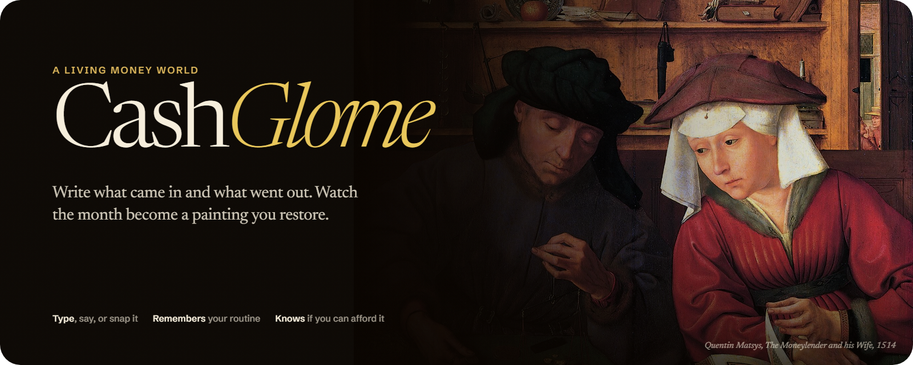
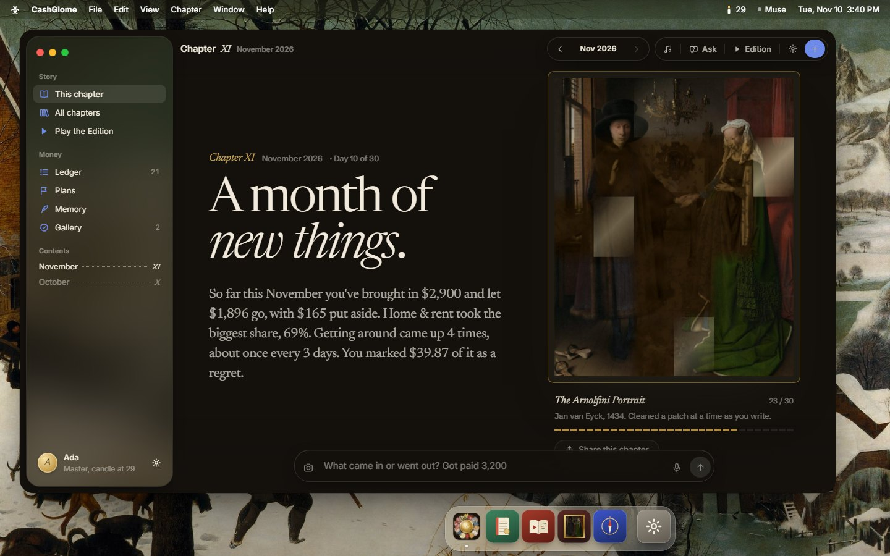
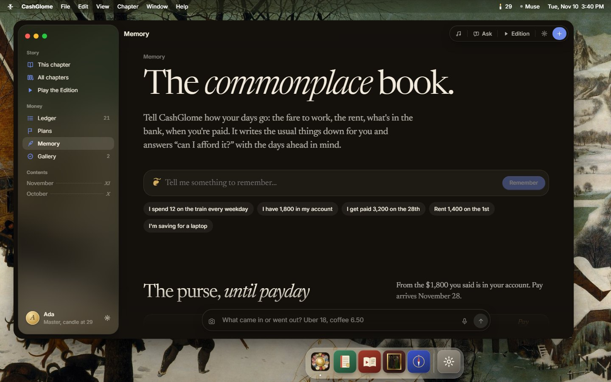
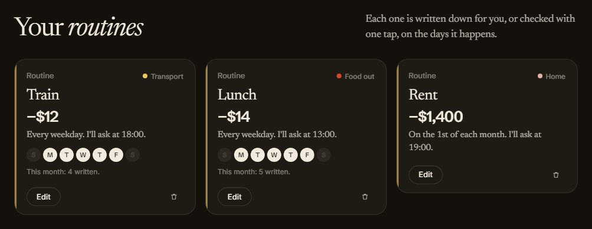
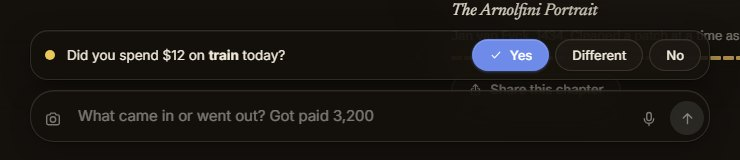
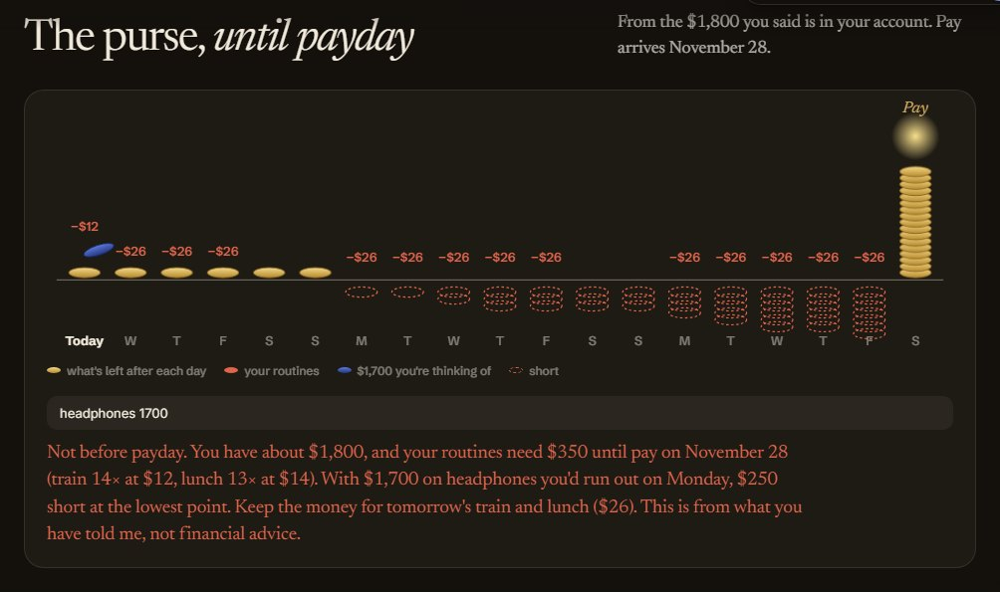
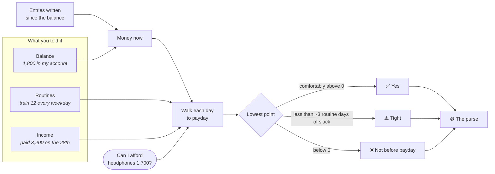
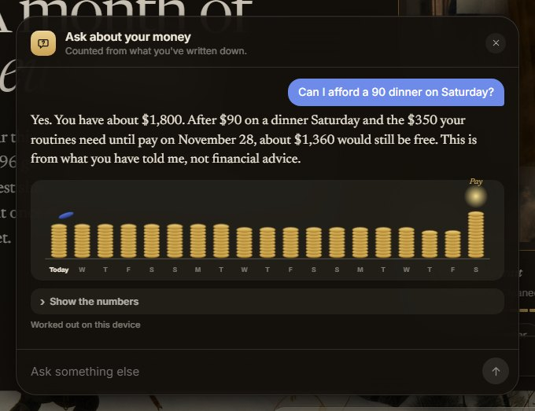
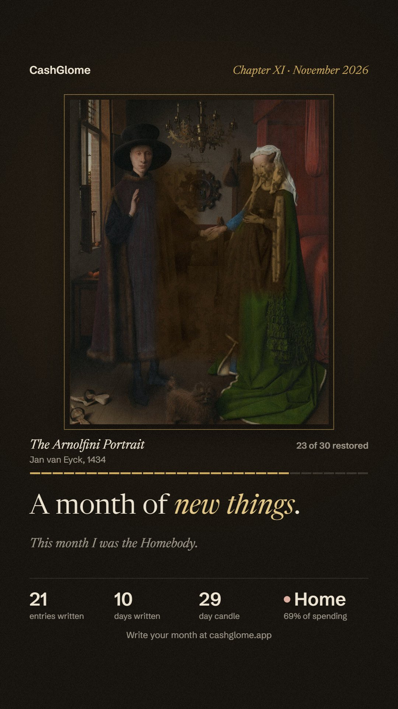
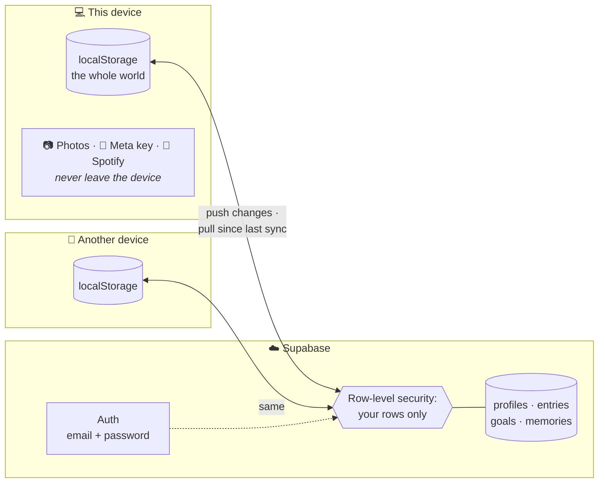

<div align="center">



<br>

**Write what came in and what went out. Watch the month become a painting you restore.**<br>
<sub>Type it, say it, or snap the receipt. CashGlome remembers how your days go, and knows whether you can afford it.</sub>

<br>

### [Open it in your browser →](https://cashglome.vercel.app/app/)
<sub>No install, works on a phone · [The website](https://cashglome.vercel.app) · [Run it yourself](#viii-run-it) · [Set up your own](SETUP.md)</sub>

<br>


[](https://cashglome.vercel.app/app/)

[**The idea**](#i-the-idea) ·
[**Memory**](#ii-the-commonplace-book) ·
[**Can I afford it?**](#iii-the-purse-until-payday) ·
[**Writing**](#iv-three-ways-in) ·
[**Ask**](#v-ask-about-your-money) ·
[**The edition**](#vi-how-it-reads) ·
[**Accounts & sync**](#vii-accounts-and-sync) ·
[**Run it**](#viii-run-it)

</div>

<br>



<br>

## Choose your path

| You are… | Start here |
|---|---|
| 🌐 **Just curious** | [cashglome.vercel.app/app](https://cashglome.vercel.app/app/), in any browser, phone included. No install, no account, nothing to paste. |
| 🪶 **Someone with money to keep** | Open the app, write one line ("lunch 4.5k, bolt 6k"), then tell **Memory** how your days go. [The commonplace book →](#ii-the-commonplace-book) |
| 🧮 **Curious how "can I afford it" works** | Balance, routines and payday, run day by day. [The purse →](#iii-the-purse-until-payday) |
| 🛠️ **A developer** | `npm install && npm run dev`. [Run it →](#viii-run-it) · [Project map →](#project-map) |
| ☁️ **Self-hosting with accounts** | One Supabase project, one SQL file, two env vars. [Accounts & sync →](#vii-accounts-and-sync) |

<br>

## I. The idea

Most money apps are spreadsheets with a guilt trip. CashGlome is a **book**. Each month is a chapter with a headline, the figures, where it went, who you were, and what could be. Each chapter hangs beside an old master painting under dark varnish. **Writing things down cleans it**, patch by patch, until by month's end the painting is restored.

It runs without a bank login and without an account. An account is optional and only keeps your world on more than one device.

<br>

## II. The commonplace book

> *Renaissance readers kept a commonplace book: one notebook for everything worth remembering. CashGlome keeps one about your money.*



Tell it how your days go, in your own words:

```text
I spend 4k on transport every weekday when I go to work
I have 40,000 naira in my bank
I get paid 250k on the 28th
Rent 120k on the 1st
My mum sends me 20k every month
I'm saving for a laptop
```

Each line becomes a **memory** CashGlome reads and acts on:

| Kind | Example | What CashGlome does with it |
|---|---|---|
| **Routine** | "Train 12 every weekday at 6pm" | On each of those days, writes the entry for you, or asks one tap: *Did you spend $12 on train today?* |
| **Balance** | "I have 1,800 in my account" | Today's money = that balance + everything you've written since. |
| **Income** | "I get paid 3,200 on the 28th" | Knows when the purse fills up again. |
| **Note** | "I'm saving for a trip to Lisbon" | Context for Ask and for Florin. |



**Routines run themselves.** Choose per routine:

- **Ask me**: a quiet check-in appears above the composer, with *Yes*, *Different* (another amount) or *No*. When several are waiting, *Yes to all*.
- **Write it for me**: the entry is written at its time, with an Undo.

<div align="center"></div>

If the window is in the background, the check-in also arrives as a system notification.

**Your memory is yours to edit, delete and restore.**

- **Edit**: change the words, amount, days, time or category. Every edit keeps the earlier version (up to eight), and *Earlier versions* puts any of them back.
- **Forget**: it moves to *Recently forgotten* for 30 days, where **Restore** brings it back exactly as it was.
- **Forget for good**: removes it now, on this device and on every device you've signed in on.

You can also tell it from the composer: start a line with *remember*, *keep in mind* or *note that*, and the quill picks it up.

<br>

## III. The purse, until payday

The question the commonplace book exists to answer:

> *"I have ₦40,000. Transport is ₦20,000 a day and I have to go to work tomorrow. Can I buy a ₦5,000 comic?"*
>
> **Not before payday.** Even without it, tomorrow's transport leaves you short. Keep the money for tomorrow's transport (₦20,000).

CashGlome walks forward **one day at a time** from now to your next payday. Each day it takes away the routines due, adds any income, and watches for the lowest point. Then it draws it:



- **Gold stacks**: what's left after each day.
- **Vermilion figures**: your routines.
- **The lapis coin**: the thing you're thinking of buying.
- **Dashed coins below the line**: days you'd be short.
- **The sun**: payday.



The verdict is **tight** when what's left at the lowest point is under three days of your usual routines, or under 10% of your balance, whichever is larger. Every answer ends with *not financial advice*. It's arithmetic on what you told it, not a licensed opinion.

Ask it anywhere: type the thing and the price on the Memory page, or ask in the composer ("can I afford a 90 dinner on Saturday?").

<br>

## IV. Three ways in

The composer has a camera on the left, words in the middle and a microphone on the right.

- **Type.** "Bolt 6k, data 3k, lunch 4.5k" becomes three entries. Chips above the field show what will be saved before you press Enter. Tap an amount to flip in/out, or a name to change the category.
- **Say.** Tap the mic and speak. Words appear as you talk, spoken numbers become digits ("four thousand five hundred", "two point five million"), and nothing is saved until you press send.
  - Browser: the Web Speech API (Chrome, Edge, Safari).
  - Windows app: Windows' own **offline** recogniser (System.Speech), via `electron/speech.cjs`.
  - Elsewhere the mic button is hidden.
- **Snap.** Use the camera button, or drop or paste a photo.
  - **Receipts** are read **on this device** with Tesseract (`public/ocr`, bundled). CashGlome finds the shop, the *total paid* (not subtotal, VAT or change) and the date, rings the total in gold, and prefills one editable line.
  - **Things you bought** are repainted as an old-master oil painting, entirely on the device (`src/lib/paint.ts`): a Kuwahara filter, brushstrokes along the forms, an umber-to-ivory grade, canvas weave and craquelure. Then it hangs in a gilt frame.
  - Photos are always read on the device; nothing is uploaded.

<details>
<summary><b>Where your paintings show up</b></summary>

- As thumbnails in the Ledger (an entry's inspector can add or take down a photo).
- In the chapter's *Painted this month* row.
- On the Gallery's green-walled **Your still lifes**, each with a brass plaque.

Photos live in IndexedDB on the device, are never synced or exported, and are deleted a few minutes after their entry is.
</details>

<br>

## V. Ask about your money

Type or say a question in the same box (or press `Ctrl/⌘ K`): *Where did my money go this month? When did I last buy suya? Am I spending more than last month? How much do I have?*



- **Exact numbers, always.** Florin, a Gemini conversation, reads the question and calls tools that run on the device (`search_entries`, `can_afford`). **The device does every sum.** Florin only writes the sentence, and *Show the working* lists the figures behind any answer.
- **It knows your book, not your entries.** Florin gets a summary (this month's totals by category, what's free to spend, who owes whom), never the lines themselves.
- **Said plainly before anything is sent.** Ask says what goes to Gemini: your question and that summary.
- **Works offline.** Ask sends nothing then: Gemini Nano answers if the browser has it, the book's own rules if not. Totals, top categories, comparisons, "when did I last…" and "can I afford" are always counted on the device.

<br clear="right">

<br>

## VI. How it reads

CashGlome is dressed as a Renaissance edition. Sixteen public-domain paintings by Bruegel, Van Eyck, Matsys, Holbein, Caravaggio, Raphael, Botticelli and Dürer. A pigment palette of lapis, gold leaf, vermilion and terre verte on warm paper. Newsreader with Schibsted Grotesk. The paintings breathe: a slow camera drift, a shaft of light, gold dust in the air, film grain. *Reduce motion* holds them still.

<table>
<tr>
<td width="38%"></td>
<td>

| Part | What it does |
|---|---|
| **This chapter** | The month's painting, chosen for who you were (*The Moneylender* for a saver, *Icarus* for an overreacher), cleaned as you write. Then the figures, **100 coins on a velvet tray** (one per hundredth of the month), your collectible character card, *How it felt*, *What could be*, repeat payments. |
| **All chapters** | Every month bound as an oxblood book; the less restored, the more faded. |
| **The Edition** | The month as an illustrated book read like a short film, seven living pages. |
| **Gallery** | A salon wall of every month's painting, the candle, wax seals, guild ranks from Apprentice to Medici. |
| **Memory** | The commonplace book and the purse. |
| **Share** | A card for stories or posts. Amounts are hidden unless you choose to show them. |

</td>
</tr>
</table>

<details>
<summary><b>Why people come back (and why it's on their side)</b></summary>

The loop rewards **writing things down and keeping money**, never spending.

- **Restoration.** Every entry cleans part of the painting. Only the first three lines each day count, so coming back daily beats writing everything at once. About one entry in seven is *gilded* and cleans an extra patch.
- **The candle.** It grows every day you write. Each 7-day run earns a wax seal (hold up to two), which protects the candle through a missed day.
- **Today's card.** One new observation from your own entries, each day.
- **Collection.** One painting a month joins your wall.
- **Evening reminder.** Optional. Fires only if today's candle is still unlit.
</details>

<details>
<summary><b>Built against the usual complaints</b></summary>

| Complaint | CashGlome |
|---|---|
| Bank sync breaks silently | No bank connection to break. If Florin can't be reached, the book's own rules answer instead. |
| Typing everything is tedious | One line for many entries, voice, receipts, one-tap repeats, and **routines that write themselves**. |
| Categories are wrong and never learn | Fix one once and it's remembered. |
| The AI gets numbers wrong | Every sum is counted on the device, and every answer can show its working. |
| "Can I afford it?" ignores tomorrow | The purse walks every day to payday with your routines in it. |
| Phone-only / subscription | Web, Windows and Mac. Account optional. |
| Can't add things offline | Fully offline. Sync catches up when you're back. |
</details>

<details>
<summary><b>On a wide screen, a whole desktop</b></summary>

In a browser on a wide screen, CashGlome draws a Mac desktop around itself: a seasonal painting as wallpaper, a menu bar with working menus, the candle streak and a clock, desktop widgets, a window you can drag, zoom and minimise, and a magnifying dock with Renaissance icons. The Electron app is the window itself, with the painting showing through its glass sidebar.
</details>

<details>
<summary><b>Fast on ordinary laptops</b></summary>

Tested on Intel UHD 620 integrated graphics: page switches draw in the same frame, changing month takes about 60–90 ms (down from ~800 ms), and typing stays at 60 fps.

- Paintings under varnish are drawn once, by a background worker, into an ordinary image.
- Nothing moves behind frosted glass; film grain is a still texture; paintings pause off-screen.
- Each painting comes in three sizes (`public/art`, `art/md`, `art/sm`). Regenerate with `npx electron scripts/make-art-sizes.cjs`.
- The 100 coins and daily bars animate in CSS; long pages render in stages.
- Supabase loads only when sync is switched on, so the offline build carries none of it.
</details>

<br>

## VII. Accounts and sync

Accounts are **optional**. Without one, everything stays on the device, exactly as before. With one (email and password), your world follows you to every device you sign in on.



**How sync behaves**

- **Local first.** The app always reads and writes the device copy. Sync runs in the background: after a change (2.5 s later), on focus, when you're back online, and every minute.
- **Newest edit wins**, row by row. The server refuses an older write, so an offline laptop can't overwrite what your phone changed since.
- **Deletes travel.** A deleted entry or a memory forgotten for good is removed on every device.
- **Signing up keeps what you have.** Everything already on the device goes into the new account.

**What's stored where**

| | On this device | In your account |
|---|:---:|:---:|
| Entries, goals, plans | ✅ | ✅ |
| Memory (routines, balance, payday, notes, history) | ✅ | ✅ |
| Profile, theme, settings, routine check-ins | ✅ | ✅ |
| Photos and receipt images | ✅ | ❌ |
| Spotify link | ✅ | ❌ |

> [!NOTE]
> Account data is stored in Supabase's Postgres in readable form, protected by row-level security and Supabase's encryption at rest. Whoever runs the Supabase project can read it. That was a deliberate choice, so the server can do more for you later. If you'd rather nobody could, don't sign in: the app is complete without an account.

**Leaving.** *Settings → Account & sync → Delete my account* (type `DELETE`) erases the account and every row in it from the server straight away. The device keeps its own copy until you clear it in *Settings → Your data*, where you can also export everything as JSON first.

<details>
<summary><b>Self-hosting: switch accounts on in five steps</b></summary>

1. **Create a project** at [supabase.com](https://supabase.com) (the free tier is plenty).
2. **Run the schema.** Open *SQL Editor*, paste [`supabase/migrations/20261110000000_cashglome.sql`](supabase/migrations/20261110000000_cashglome.sql) and run it. Or, with the Supabase CLI: `supabase link` then `supabase db push`. It creates the four tables, the newest-edit-wins trigger, row-level security, and `delete_my_account()`.
3. **Add the keys.** Copy `.env.example` to `.env.local` and fill in *Project Settings → API*:
   ```bash
   VITE_SUPABASE_URL=https://your-project.supabase.co
   VITE_SUPABASE_ANON_KEY=your-anon-key
   ```
   The anon key is meant to be public; row-level security is what keeps rows private. **Never** put the `service_role` key in the app.
4. **Email auth.** *Authentication → Providers → Email* is on by default. Under *Authentication → URL Configuration*, set the **Site URL** to where you serve the web app and add it (plus `http://localhost:5173` for development) to **Redirect URLs**. Confirmation and password-reset links come back there.
5. **Build.** `npm run build` (or `npm run dist:win`). Without the two variables, the build has no accounts and no Supabase code at all.

Confirmation emails link to the web address. Desktop users confirm in the browser, then sign in in the app.

The full walkthrough, with a check script, email setup and troubleshooting, is in [**docs/SETUP.md**](SETUP.md).
</details>

<br>

## VIII. Run it

```bash
npm install
npm run dev            # web, http://localhost:5173
npm run desktop        # desktop app (Electron)
npm run desktop:dev    # desktop app with hot reload
```

```bash
npm run build && npm run serve    # production web server (PORT, default 4173)
npm run dist:win                  # Windows installer → release/
npm run dist:mac                  # macOS .dmg (on a Mac)
node scripts/publish-web.mjs      # build into ../cashglome-site/app for cashglome.vercel.app/app/
```

`publish-web.mjs` reads `.env.local`, says which features are on (accounts), and refuses to build if a secret is about to be published. Push `cashglome-site` afterwards and Vercel deploys it. [docs/SETUP.md](SETUP.md) walks through all of it.

<details>
<summary><b>Florin (optional AI)</b></summary>

CashGlome's own parser understands `5k`, `2.5m`, `₦4,500` and `$12`, tells money in from money out, splits one line into several entries, and picks up feelings ("regret", "worth it") and dates ("yesterday", "last friday"). It needs no AI.

Florin adds Gemini through **Firebase AI Logic** (`src/stage/brain.ts`): the cloud model first, so any device is quick, and **Gemini Nano** on the device when offline. It answers questions in Ask, and reads lines written in other scripts or that the rules can't read. App Check with reCAPTCHA Enterprise guards the API, so the Firebase values in the app are public by design.

Set `VITE_FIREBASE_API_KEY`, `VITE_FIREBASE_AUTH_DOMAIN`, `VITE_FIREBASE_PROJECT_ID`, `VITE_FIREBASE_APP_ID` and `VITE_RECAPTCHA_SITE_KEY` in `.env.local` (optionally `VITE_GEMINI_MODEL`). Without them, everything is read and counted on the device. Setup is in [docs/SETUP.md](SETUP.md#b-florin-gemini-through-firebase).
</details>

<details>
<summary><b>Music (Spotify)</b></summary>

**♪** in the toolbar plays Spotify while you write: any playlist, album, song or podcast link, or one of the quiet picks. To let people choose from their own playlists, register a Spotify app (Web API), add redirect URIs `http://127.0.0.1:43821/callback` (desktop) and your web address, and set `VITE_SPOTIFY_CLIENT_ID` in `.env.local`. Sign-in uses PKCE, so no secret is stored.
</details>

<details>
<summary><b>Screenshots in this README</b></summary>

They're taken from the real app with an example world (a month of demo entries and six memories):

```bash
npm run dev
npx electron scripts/readme-shots.cjs                 # everything
npx electron scripts/readme-shots.cjs --banner-only   # just the banner
```

This writes `assets/`. The banner is a PNG with its rounded corners cut out, since GitHub ignores CSS in READMEs.
</details>

**Shortcuts.** `Ctrl/⌘ N` write · `Ctrl/⌘ K` ask · `Ctrl/⌘ 1–6` Chapter, All chapters, Ledger, Plans, Gallery, Memory · `Ctrl/⌘ [ ]` month · `Ctrl/⌘ E` Edition · `Ctrl/⌘ ,` Settings

<br>

## Project map

```
electron/           desktop shell: frameless window, offline speech
docs/               SETUP.md (accounts, Florin, publishing) and the README pictures
scripts/            desktop dev runner, icon renderer, painting sizes, README shots, publish-web
server.mjs          production web server
supabase/           database schema (migrations) and check.sql for optional accounts
src/lib/
  memory.ts         the commonplace book: reading memories, routines, the purse, affordability
  cloud.ts          Supabase auth and sync (loaded only when configured)
  useCloud.ts       background sync and its status
  ask.ts            Ask: questions counted on the device, and the searches Florin's tools run
  store.ts          the world: entries, goals, memories, merge
  analytics.ts …    parser, chapter copy, art & restoration, receipts, paint, sounds
src/stage/
  brain.ts          Gemini Nano on the device and Gemini in the cloud (Firebase AI Logic)
  florin.ts         Florin: the chat, its tools, and the working it shows
src/components/     Desktop, Shell, Composer, CheckIns, Runway, Account, ShareSheet, Coins, LivingArt…
src/views/          Chapter, Memory, Ledger, Plans, Collection, Edition, Settings, Welcome…
public/art/         sixteen public-domain paintings (Wikimedia Commons)
```

<br>

## Related repos

- [cashglome-ios](https://github.com/cashglome/cashglome-ios): the native iPhone and iPad app (SwiftUI).
- [cashglome-site](https://github.com/cashglome/cashglome-site): the website at [cashglome.vercel.app](https://cashglome.vercel.app). It also serves this app at `/app/`.

<br>

## Credits

**Paintings.** All public domain, reproduced from Wikimedia Commons, with full credits in *Settings → About*. The banner is Quentin Matsys, *The Moneylender and his Wife* (1514, Louvre). The chapter above is Jan van Eyck, *The Arnolfini Portrait* (1434, National Gallery).

**The icon.** A gold florin with a beaded rim, the legend FLORENTIA and an embossed lily, in a wreath of flowers cut from Ambrosius Bosschaert the Elder's *Vase of Flowers in a Window* (c. 1618, Mauritshuis). Drawn by `scripts/logo.html`; regenerate with `npx electron scripts/make-logo.cjs`.

<div align="center">
<br>
<sub><i>CashGlome gives general money insights, not licensed financial advice.</i></sub>
<br><br>

</div>
